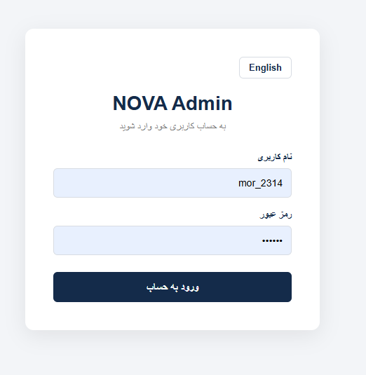
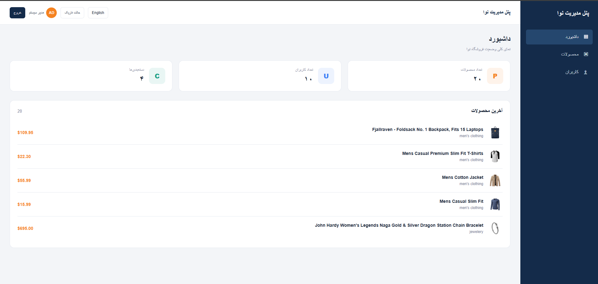
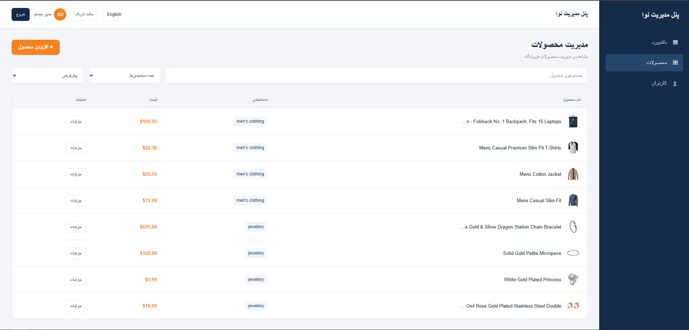
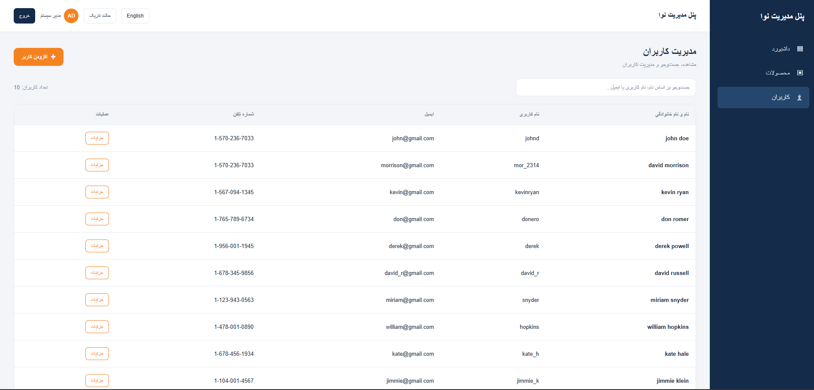
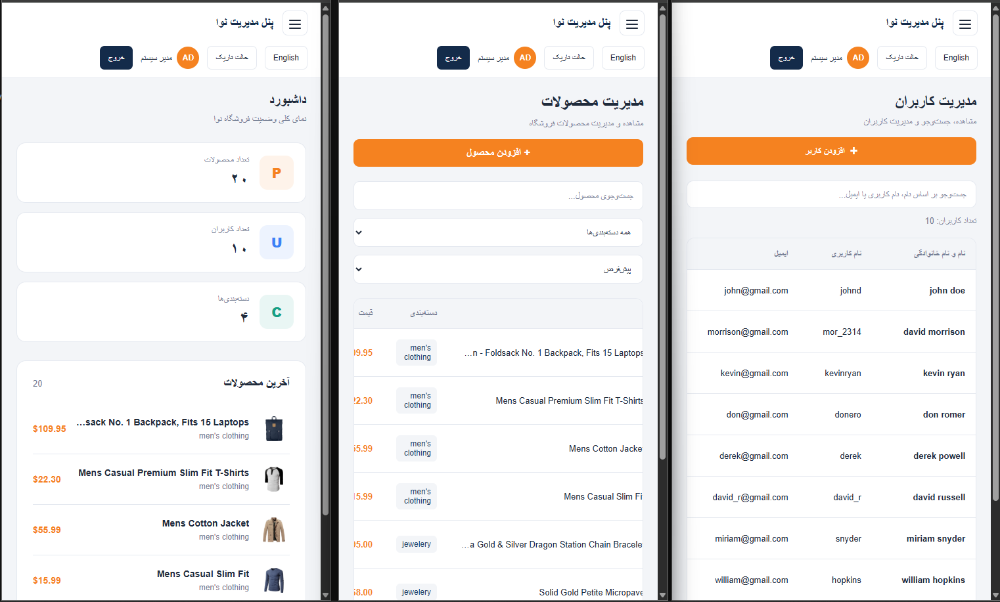

# NOVA Admin

A responsive, bilingual admin dashboard built with **React 19, TypeScript, Vite, and Redux Toolkit** as part of the NOVA Frontend Technical Challenge.

The application provides an administrative interface for managing products and users, viewing store statistics, and handling authentication through protected routes.

## Screenshots

### Login


### Dashboard


### Products Management


### Users Management


### Responsive Design



## Features

- **Authentication:** Login, authentication state management, and protected routes.
- **Dashboard:** Store overview and summary cards.
- **Products Management:** Fetch, search, filter, view product details, and add products.
- **Users Management:** Fetch, search, view user details, and add users.
- **Internationalization:** Persian and English language support.
- **Theming:** Light and Dark modes.
- **Responsive Design:** Adaptive layout for desktop and mobile screens.
- **Form Validation:** Formik and Yup validation schemas.
- **API Error Handling:** Centralized API error handling with localized error messages.
- **Code Splitting:** Lazy loading for application pages.

## Tech Stack

| Technology | Purpose |
|---|---|
| React 19 | UI development |
| TypeScript | Static typing |
| Vite | Development server and build tooling |
| Redux Toolkit | Application state management |
| React Redux | Connecting React components to Redux |
| React Router DOM | Routing and protected routes |
| Axios | HTTP requests |
| Formik | Form state management |
| Yup | Form validation |
| Styled Components | Component-based styling |

## Architecture & Project Structure

The project follows a feature-oriented structure with shared components, utilities, state management, and validation logic separated into dedicated directories.

```text
src/
├── Components/
│   └── Layout/
├── Dictionary/
├── Pages/
│   ├── Auth/
│   ├── Dashboard/
│   ├── Products/
│   └── Users/
├── Redux/
│   └── Slices/
├── Routes/
├── Shared/
│   ├── Providers/
│   └── Theme/
├── Storage/
├── types/
├── Utils/
│   ├── api/
│   └── services/
└── Validations/
```

### Key Technical Decisions

- **State Management:** Redux Toolkit with typed hooks for predictable and type-safe application state management.
- **API Layer:** Axios configuration and service modules separate HTTP communication from UI components.
- **Async Operations:** Redux async thunks manage API operations and their loading and error states.
- **Validation:** Formik and Yup schemas are separated from page components for better maintainability and reusability.
- **Component Organization:** Products and Users pages are divided into smaller components and custom hooks.
- **Internationalization:** Centralized translation dictionaries support Persian and English.
- **Theming:** Shared theme configuration supports Light and Dark modes.
- **Routing:** React Router DOM handles application navigation and protected routes.
- **Performance:** Route-level lazy loading reduces the initial JavaScript bundle size by loading pages when needed.
- **Error Handling:** API errors are handled centrally and displayed through localized application messages.

## Getting Started

### Prerequisites

- Node.js
- npm

### 1. Clone the repository

```bash
git clone https://github.com/mohammadiyasaman/nova-admin.git
cd nova-admin
```

### 2. Install dependencies

```bash
npm install
```

### 3. Configure environment variables

Create a `.env` file in the project root:

```env
VITE_API_BASE_URL=https://fakestoreapi.com
```

### 4. Run the development server

```bash
npm run dev
```

The application will be available at the local URL provided by Vite.

## Demo Credentials

Use the following Fake Store API test account:

| Field | Value |
|---|---|
| Username | `mor_2314` |
| Password | `83r5^_` |

## Available Scripts

| Command | Description |
|---|---|
| `npm run dev` | Start the Vite development server |
| `npm run build` | Run TypeScript checks and create a production build |
| `npm run lint` | Run ESLint |
| `npm run preview` | Preview the production build locally |

## API

This project uses [Fake Store API](https://fakestoreapi.com/) for authentication and product/user data.

**Note:** Fake Store API is a demo API. Create operations may return simulated responses and are not guaranteed to persist data on the server.

## Author

**Yasaman Mohammadi**

[GitHub Repository](https://github.com/mohammadiyasaman/nova-admin)
